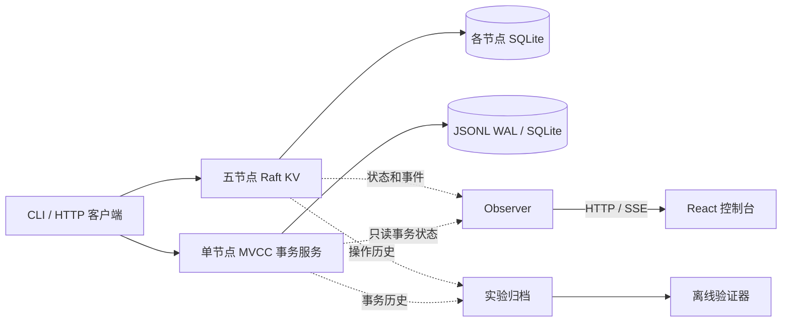

<h1 align="center">Distributed Database</h1>

<p align="center">
  分布式数据库课程设计<br>
  Raft 一致性复制 · MVCC 事务隔离 · WAL 崩溃恢复 · 离线一致性验证
</p>

<p align="center">
  <a href="#-快速开始">快速开始</a> ·
  <a href="#-系统架构">系统架构</a> ·
  <a href="#-测试与实验">测试与实验</a> ·
  <a href="#-常用命令">常用命令</a> ·
  <a href="#-文档导航">文档导航</a>
</p>

<p align="center">
  
  
  
  
  
</p>

> [!TIP]
> **封档前提醒** · 课程设计报告（Report）待定稿并归档。项目封档时移除此提示。

## 项目简介

项目包含一个五节点 Raft KV 复制组和一个独立运行的单节点 MVCC 事务服务。Raft 负责 KV 状态机的选举、复制和提交。事务服务负责 RC / SI 隔离、版本可见性、写冲突检测和 WAL 崩溃恢复。两个服务分别维护各自的持久化状态与提交边界。

观测控制台提供集群拓扑、实时事件、故障实验回放以及事务和恢复记录。离线验证器读取已归档的操作历史，检查线性化、事务依赖环和业务不变量。每次实验以独立 Run ID 归档，判定可以追溯到命令、运行环境、事件和原始日志。

## 快速开始

### 1. 环境与依赖

| 依赖 | 版本或要求 | 用途 |
| --- | --- | --- |
| Node.js | `24.21.0`，见 [`.node-version`](.node-version) | 运行 TypeScript 脚本和内置 `node:sqlite` |
| pnpm | `11.25.0`，见 [`package.json`](package.json) | 安装依赖，执行开发和实验命令 |
| Docker | Docker Desktop 或 Docker Engine，含 `docker compose` 插件 | 运行 Raft 集群、事务服务和容器故障实验 |
| 浏览器 | 现代浏览器 | 使用 React / Vite 观测控制台 |

自动化测试、类型检查、前端构建和离线验证只需要 Node.js、pnpm 和项目依赖。运行集群、事务服务或实时观测前，先启动 Docker。

```sh
git clone https://github.com/13776578253-glitch/Distributed-Database.git
cd Distributed-Database
pnpm install --frozen-lockfile
```

### 2. 启动 Raft 集群

```sh
pnpm demo
```

该命令构建镜像，重建所选 Compose 项目的五个节点容器并复用外部数据卷。节点就绪后，脚本等待 Leader 当选，执行一轮写入、读取和删除，并将结果写入 `evidence/SMOKE/<Run ID>/`。

默认端口为本机 `18081` 至 `18085`，对应 `raft-1` 至 `raft-5`。可请求任意节点的 `GET /health` 和 `GET /internal/raft/status`。Leader 提供 `POST /kv/put`、`GET /kv?key=x` 和 `POST /kv/delete`。写入请求使用 `{"key":"x","value":1}`，删除请求只传 `key`。

### 3. 打开观测控制台

```sh
pnpm console
```

打开 [http://127.0.0.1:5173](http://127.0.0.1:5173)，可通过 `CONSOLE_PORT` 修改端口。控制台会挂接所选 Compose 项目中的现有 Raft 容器，项目中没有节点容器时则启动集群。已有停止的节点保持原状态。按 Ctrl+C 退出控制台后，集群继续运行。

Raft 页显示节点角色、任期、提交进度和 SSE 实时事件，并提供实验回放。事务页展示只读历史查询、WAL 和恢复报告。验证页从 V01–V03 的归档记录展示判定、依赖关系和原始历史。

### 4. 启动独立事务服务（可选）

```sh
docker compose -f compose.transaction.yaml up -d --build transaction
docker compose -f compose.transaction.yaml port transaction 8080
```

使用第二条命令返回的本机地址访问 `GET /health` 或 `GET /txn/status`。通过 `POST /txn/begin` 选择 `RC` 或 `SI`，再向 `/txn/<id>/read`、`put`、`delete`、`commit` 或 `abort` 发送 POST 请求。使用 `GET /txn/as-of?key=x&lsn=N` 按 WAL LSN 读取已提交历史。

控制台自动发现默认事务项目 `minidb-txn`。如用 Compose 的 `-p` 指定了项目名，启动控制台前将 `CONSOLE_TXN_PROJECT` 设为同一名称。

## 系统架构



| 路径 | 职责 |
| --- | --- |
| `src/raft/` | Raft 协议核心、SQLite 持久化、HTTP 传输和 KV API |
| `src/transaction/` | MVCC 版本链、RC / SI、WAL 和 ARIES 风格恢复 |
| `src/verification/` | 寄存器线性化、WW / WR / RW 依赖图和业务不变量 |
| `src/contracts/` | 操作历史、事务和观测的共享契约 |
| `src/observer/`、`web/` | 观测数据、实时事件、实验回放和 Web 界面 |
| `scripts/`、`tests/` | 启动与实验脚本、自动化测试 |

## 测试与实验

### 自动化测试

在仓库根目录执行。

```sh
pnpm test           # Vitest 测试，覆盖 Raft、事务恢复、验证器和观测数据
pnpm typecheck      # TypeScript 类型检查，含 Web 控制台
pnpm build:web      # 构建前端，产物位于 dist/console/
```

### 容器实验与离线验证

| 命令 | 前置条件与检查内容 |
| --- | --- |
| `pnpm demo` | 启动 Docker，检查五节点健康、选举和 KV 读写删 |
| `pnpm experiment R01` | 先运行 `pnpm demo`，检查 Leader 终止后的重新选举 |
| `pnpm experiment R02` | 先运行 `pnpm demo`，检查 3–2 分区下的少数派拒写与恢复收敛 |
| `pnpm experiment R03` | 先运行 `pnpm demo`，采集并发操作历史 |
| `pnpm txn:experiment T01` | 独立事务容器与数据卷，检查 WAL 提交边界和恢复后历史读 |
| `pnpm txn:experiment T02` | 独立事务容器与数据卷，检查 SI 写偏斜和具名锁 |
| `pnpm txn:experiment T03` | 独立事务容器与数据卷，检查恢复中断后的 CLR 补偿撤销 |
| `pnpm verify` | 离线读取仓库已有的 R03、T02 历史，生成 V01–V03 验证记录 |

R01 和 R02 会终止节点或临时阻断所选项目的节点间通信。使用独立集群时，先在同一个终端设置 `RAFT_LAB_NAME` 和 `RAFT_PORT_PREFIX`，再运行 `pnpm demo` 和实验命令。E1、E2、E3B 和 E4B 的批量写入、安全读、快照和成员变更步骤见[实验清单](docs/experiments.md)及 [Raft 扩展设计](docs/raft-extensions.md)。E3B 需要独立的五节点集群，E4B 需要启用 `RAFT_MEMBERSHIP=1` 的独立六节点环境。

要回放指定的 R03 历史，在 `pnpm verify V01` 后加对应 Run ID。例如：

```sh
pnpm verify V01 2026-11-07T12-03-08.334Z--8c1d3503
```

### 查看实验证据

在[实验审计索引](evidence/README.md)中按实验编号定位 Run。每次运行归档到 `evidence/<实验编号>/<Run ID>/`。先看 `result.json` 的判定和断言，再用 `metadata.json` 确认 Git SHA、环境和参数，最后对照 `command.txt`、`events.jsonl` 和 `raw.log` 追溯执行过程。

## 常用命令

| 命令 | 用途 |
| --- | --- |
| `docker compose ps` | 查看所选 Raft 项目的容器状态 |
| `pnpm membership status` | 查看成员变更实验环境的投票配置 |
| `docker compose down` | 停止并移除 Raft 容器，保留外部数据卷。六节点环境使用 `docker compose --profile membership down` |
| `docker compose -f compose.transaction.yaml down` | 停止并移除事务容器，保留事务数据卷 |

需要清空所选 Raft 项目的容器及数据卷时，使用 `pnpm reset:destructive --confirm`。该操作会删除卷内的持久化数据。

## 文档导航

| 文档 | 内容 |
| --- | --- |
| [系统设计](docs/system-design.md) | 模块边界、协议和数据流 |
| [开发计划](docs/PLAN.md) | 阶段范围和验收安排 |
| [实验清单](docs/experiments.md) | 实验步骤、故障条件和判定标准 |
| [实验审计索引](evidence/README.md) | 各 Run 的结果、日志和截图 |
| [Raft 扩展设计](docs/raft-extensions.md) | 批量写入、安全读、快照和成员变更 |
| [架构选型比较](docs/comparison.md) | 与相关分布式存储方案的比较 |
| [开发任务记录](docs/current-task/) | 实现、验收和修复记录 |
| [AI 使用记录](AI_USAGE.md) | AI 参与范围和核验方式 |
