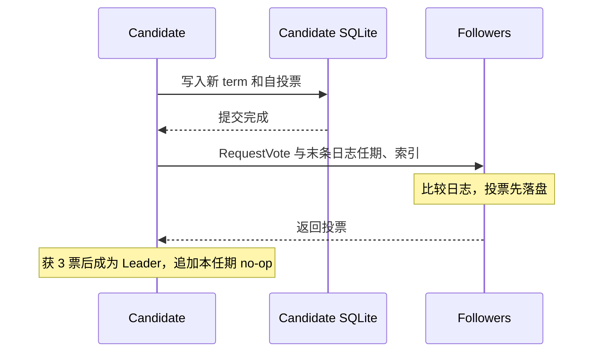
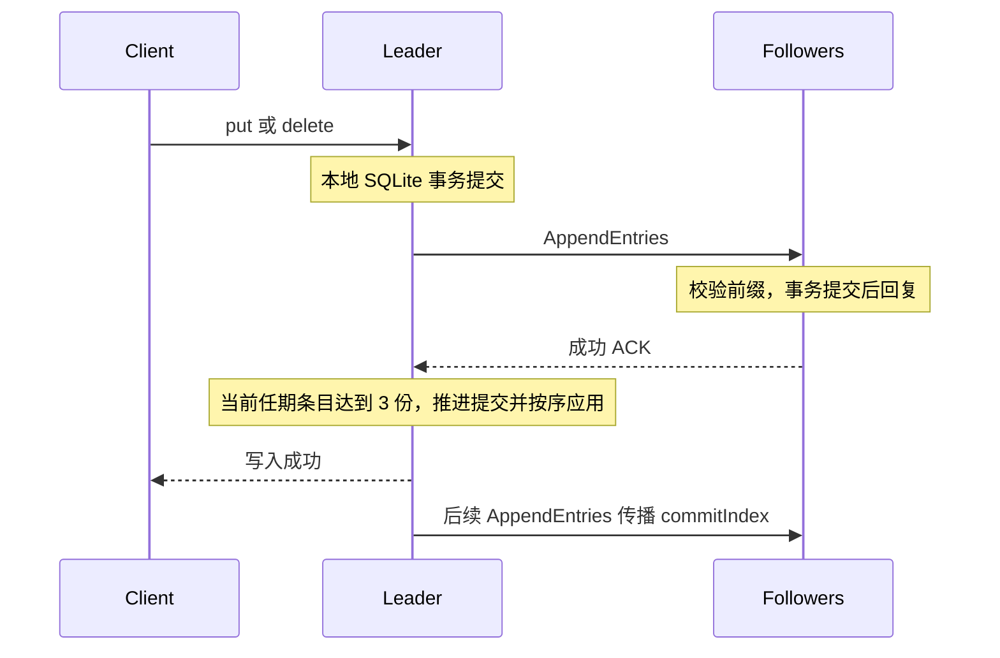
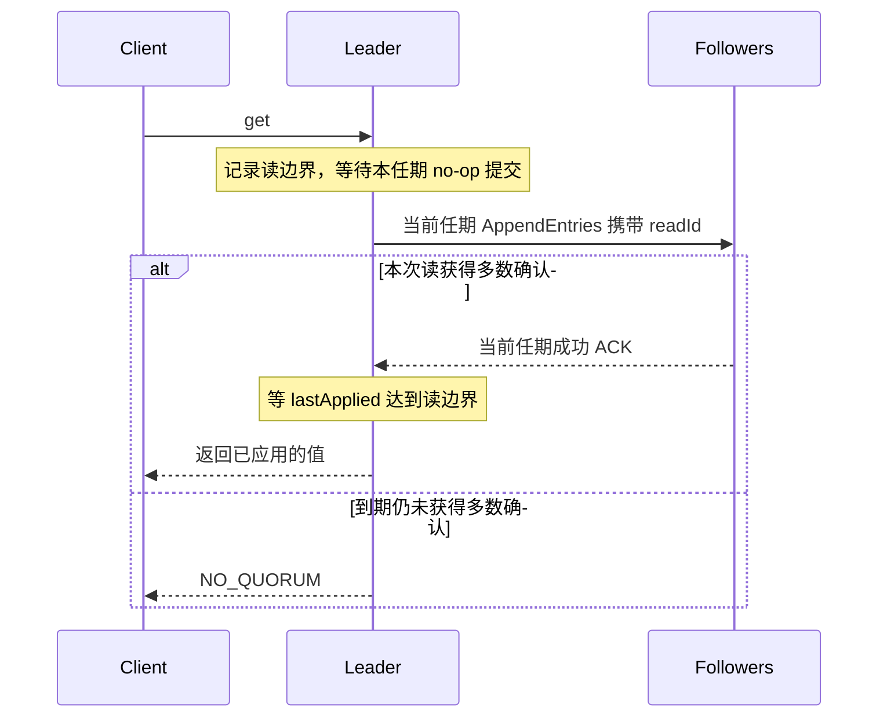

# 方向一 Raft KV 必做项核对报告

2026-11-06。核对范围为五节点 Raft KV 的必做功能、三项破坏实验和对应证据。运行镜像的源码提交为 `90d642a`，本轮对照该提交与当前仓库的 Raft 源码、测试、脚本和镜像配置，内容一致。

**结论：本次列出的必做功能和三项破坏实验均完成。** 杀 Leader 和 3–2 分区使用五个独立 Compose 容器。跨任期提交使用可控消息顺序复现，补验加载同一镜像内的实际 Raft 核心和 SQLite，在隔离容器内执行。方向一原交付清单中的并发历史检查另由 R03 跟踪，当前已有历史，判定待 S4。

## 功能逐项核对

| 检查项 | 核对结果 | 依据 |
| --- | --- | --- |
| Leader Election | **通过。** 节点有 Follower、Candidate、Leader 三种角色。超时随机取 400–750 ms（上界不含），发起选举时先落盘新任期和自投票。每任期只授票给一个候选人。候选日志先比末条任期，任期相同再比末条索引。获得 3 票后成为 Leader，收到更高任期消息则转为 Follower。 | [运行时配置](../../src/raft/main.ts#L13) · [选举与投票](../../src/raft/core/node.ts#L151) · [投票回归测试](../../tests/raft/core.test.ts#L81) |
| Log Replication | **通过。** AppendEntries 携带前一条的索引和任期。Leader 以成功回复推进该节点的 `matchIndex`，失败时按冲突位置回退 `nextIndex`。Follower 只在首个冲突处开始替换后缀，删除与补写在一个 SQLite 事务中完成。提交索引只推进到本次已匹配的范围，条目按索引应用。 | [Leader 进度](../../src/raft/core/node.ts#L126) · [Follower 匹配与截断](../../src/raft/core/node.ts#L244) · [分区后缀修复测试](../../tests/raft/core.test.ts#L168) |
| Commit Safety | **通过。** Leader 只对当前任期条目直接按多数副本数推进 `commitIndex`，其之前的条目随前缀一同提交。跨任期补验实际观察到旧条目已在五节点落盘，而 `commitIndex` 保持 0。 | [提交规则](../../src/raft/core/node.ts#L278) · [R04](../../evidence/R04/2026-11-06T11-15-26.546Z--b81c0076/result.json) |
| KV 与 Linearizable Read | **通过。** put 和 delete 在提交并应用后返回成功。get 先等本任期 no-op 提交，再要求带本次或更晚读标识的当前任期 RPC 获得多数确认，且 `lastApplied` 到达该读的边界。少数派旧 Leader 无法取得读 quorum，返回 `NO_QUORUM`。HTTP GET 用 `found` 区分缺失和已存的 JSON null。 | [命令与读边界](../../src/raft/core/node.ts#L92) · [读确认](../../src/raft/core/node.ts#L308) · [读屏障测试](../../tests/raft/core.test.ts#L151) |
| 节点通信 | **通过。** RequestVote 与 AppendEntries 通过 HTTP POST 传输 JSON。真实 Compose 运行日志包含节点间请求、回复和任期。 | [HTTP 传输](../../src/raft/adapters/http-transport.ts#L25) · [R01 原始日志](../../evidence/R01/2026-11-06T10-57-02.353Z--76c65d01/raw.log) |
| Persistence | **通过。** 每节点使用独立卷上的 `/data/raft.sqlite`。Leader 本地追加先提交 SQLite 事务，Follower 也在事务提交后才回复 AppendEntries 成功。SQLite 使用 WAL 和 `synchronous=FULL`，提交时同步 WAL。Leader 得到包含自身的多数份持久化日志后推进提交，按序应用时才向客户端确认。 | [SQLite 适配器](../../src/raft/adapters/sqlite.ts#L4) · [应用与确认](../../src/raft/core/node.ts#L290) · [SQLite 同步语义](https://sqlite.org/pragma.html#pragma_synchronous) |
| Failure Recovery | **通过。** 启动时读取 term、votedFor 和有序日志。内存 KV 随确认后的提交前缀重放。隔离进程收到投票与追加的成功应答后被 SIGKILL，重开同一卷得到原任期、投票和条目，同任期另一候选人的投票被拒绝，随后按 Leader 提交进度重新应用。 | [启动加载](../../src/raft/core/node.ts#L41) · [SQLite 重开补验](../../evidence/R04/2026-11-06T11-15-26.546Z--b81c0076/events.jsonl) |
| Network Partition | **通过。** 五个真实容器在 HTTP 传输层执行双向阻断，覆盖 6 对跨组节点、12 条有向链路。发送端跳过被阻断的对端，接收端拒绝该对端的 RPC，且阻断期间到达的在途回复被丢弃。容器间的 Docker 网络继续提供其他通信。 | [出站阻断](../../src/raft/adapters/http-transport.ts#L21) · [入站阻断](../../src/raft/api/http.ts#L84) · [R02 故障步骤](../../evidence/R02/2026-11-06T10-57-06.906Z--77080c4c/events.jsonl) |

对照采用 Raft 论文图 2、§5.2–5.4 和 §8 的投票、复制、跨任期提交与只读规则。 [Raft 扩展论文](https://raft.github.io/raft.pdf)

## 三项破坏实验

### 1. R01 · 强制杀死 Leader

两次成功写入同一键，先写 `previous`，再写 `confirmed`。对 `raft-1` 执行 SIGKILL，容器退出码为 137。实验驱动从发出故障命令到发现已就绪的新 Leader 用时 **844.327 ms**，阈值为 8 秒。首次恢复服务时 Leader 为 `raft-5`，任期从 8 进入 9。随后一致性读返回 `confirmed`。旧节点回归时曾发起额外选举，其较旧日志的投票请求被拒，集群最终在任期 11 再次收敛，五节点提交索引、应用索引和提交前缀一致。 [判定和计时](../../evidence/R01/2026-11-06T10-57-02.353Z--76c65d01/result.json) · [原始日志](../../evidence/R01/2026-11-06T10-57-02.353Z--76c65d01/raw.log)

### 2. R02 · 五节点 3–2 分区

少数派为 `raft-4`（原 Leader）和 `raft-1`，多数派为 `raft-2/3/5`。断开跨组 RPC 后，多数派在任期 12 选出 Leader，写入与读回均成功。原 Leader 的写提议返回 HTTP 504 `UNKNOWN_OUTCOME`，读返回 HTTP 503 `NO_QUORUM`。`UNKNOWN_OUTCOME` 表示这次调用未获成功确认。恢复链接后，五节点的 `commitIndex`、`lastApplied` 和日志长度均为 24，提交前缀哈希一致。多数派的值仍可读，本次少数派冲突提议对应的键缺失。 [判定](../../evidence/R02/2026-11-06T10-57-06.906Z--77080c4c/result.json) · [事件](../../evidence/R02/2026-11-06T10-57-06.906Z--77080c4c/events.jsonl)

### 3. R04 · 旧任期多数副本

任期 1 的 Leader 通过实际 put 请求与内部 no-op 形成 65 条本地日志。用同一 SQLite 重建该节点，让它进入任期 2 并成为 Leader。控制消息投递，让前 64 条旧任期日志复制到所有五个节点，任期 2 的 no-op 暂时只在 Leader 落盘。在此时点记录到 `commitIndex=0` 和 `lastApplied=0`。放行当前任期条目后，提交和应用均推进到 66，五节点前缀相同，读回最后一笔 put 的值 63。 [判定](../../evidence/R04/2026-11-06T11-15-26.546Z--b81c0076/result.json) · [原始输出](../../evidence/R04/2026-11-06T11-15-26.546Z--b81c0076/raw.log) · [命令](../../evidence/R04/2026-11-06T11-15-26.546Z--b81c0076/command.txt) · [探针](../../evidence/R04/2026-11-06T11-15-26.546Z--b81c0076/probe.mjs)

## 三条实现时序

### 选举

### 日志复制与写入确认

### 一致性读

## 本轮复核与复现

- 重新执行 `pnpm test`，7 项 Raft 核心测试、2 项契约测试通过。`pnpm typecheck`、`docker compose config --quiet` 通过。
- 只读查看在线集群，五容器均为 healthy，本次查询时同为任期 12、提交索引 27、应用索引 27，提交前缀哈希一致。
- `pnpm demo`、`pnpm experiment R01` 和 `pnpm experiment R02` 可按顺序复现启动与两项真实容器实验。跨任期回归可执行 `pnpm exec vitest run tests/raft/core.test.ts -t "does not commit an old-term batch"`，磁盘补验按 R04 的命令文件复跑。 [启动验证](../../evidence/SMOKE/2026-11-06T10-56-45.707Z--a7f97de8/result.json) · [R04 复跑命令](../../evidence/R04/2026-11-06T11-15-26.546Z--b81c0076/command.txt)
