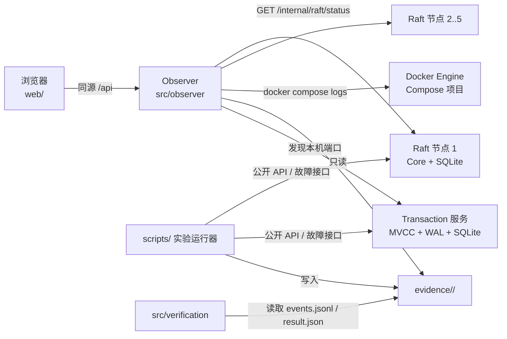
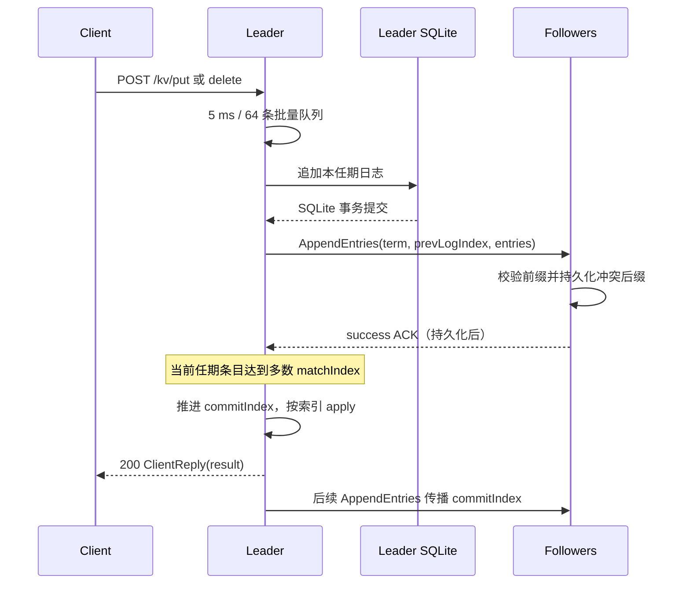
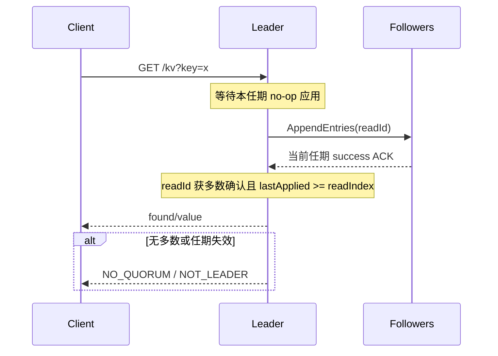
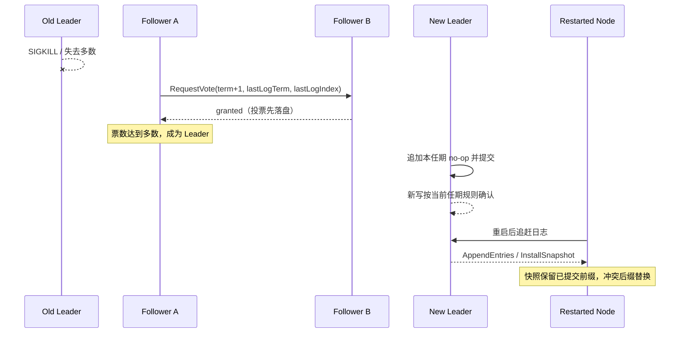
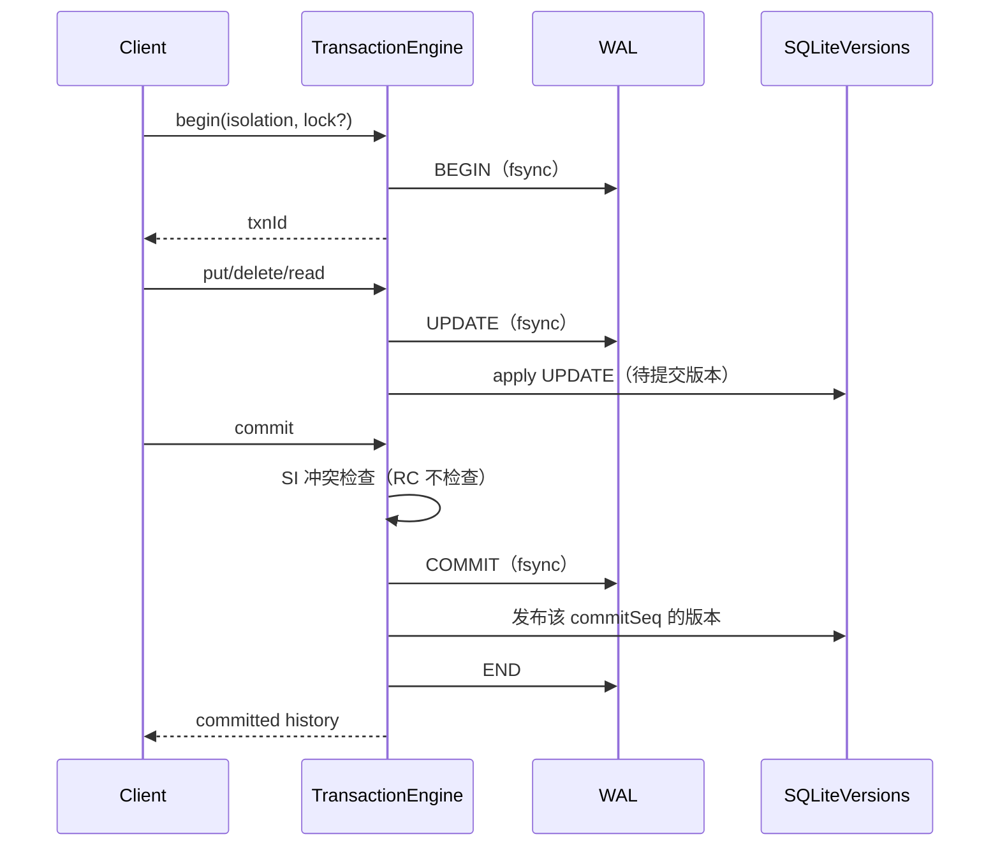
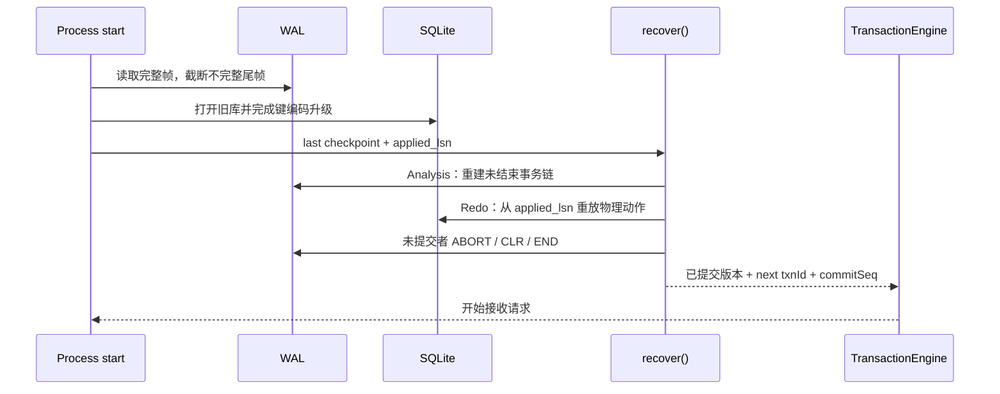
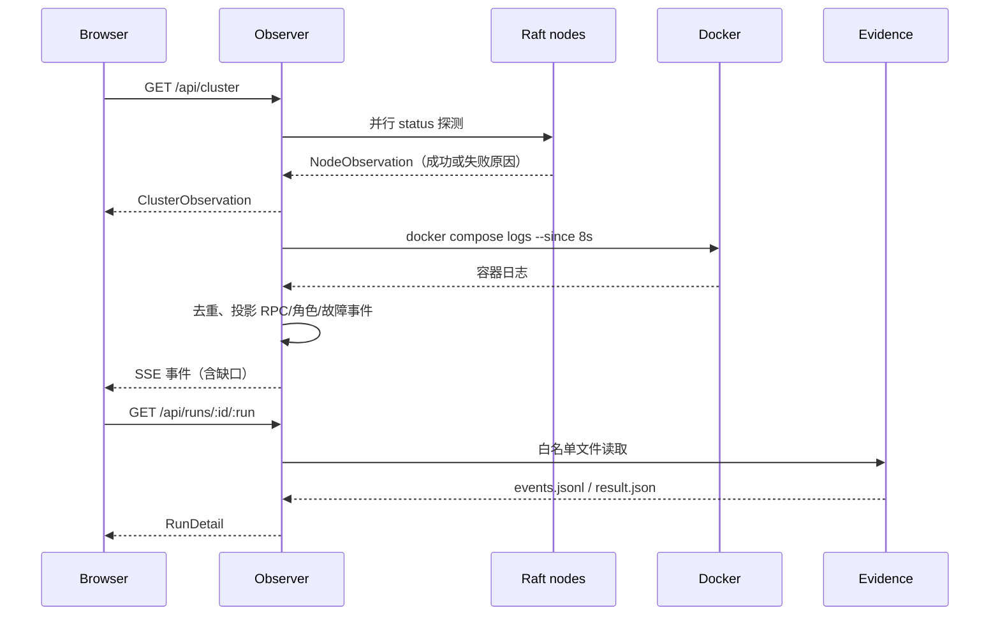
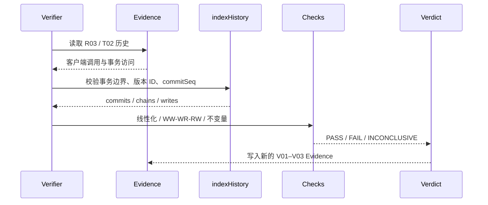

# 系统设计：架构、流程与数据结构

本文描述提交版系统的职责边界、关键流程、数据结构和已知失效边界。实现细节以源码为准；实验步骤和 Evidence 见 [实验清单](experiments.md) 与 `evidence/`。

## 1. 范围

项目由三个独立但可组合验证的方向组成：

- Raft KV：多节点日志复制、Leader 选举、线性化读、快照和联合配置。
- 事务服务：单节点 MVCC、WAL、SQLite 物化、Checkpoint 和 Recovery。
- 一致性验证：对客户端历史和事务读写证据做离线判定。
- 观测控制台：只读聚合 Raft 状态、容器日志和 Evidence，不参与协议决策。

非目标：跨节点分布式事务、跨 Raft 组的全局提交、多分片事务和完整的数据库 SQL 层。事务服务不与 Raft 组成两阶段提交；两者的提交边界分别验证。

## 2. 总体架构

| 组件 | 源码 | 拥有状态 | 边界 |
| --- | --- | --- | --- |
| Raft Core | `src/raft/core/` | term/vote、日志、Leader 进度、提交/应用边界、成员配置 | 纯同步状态机，不做异步 I/O |
| Raft Adapters | `src/raft/adapters/` | SQLite 日志/快照、HTTP 传输 | 持久化和网络副作用 |
| Raft API/Main | `src/raft/api/`、`src/raft/main.ts` | HTTP 路由、批量写队列、定时器 | 进程装配 |
| Transaction Core | `src/transaction/core/` | 活动事务、锁、版本链、提交顺序 | 同步事务状态机 |
| Transaction Storage | `src/transaction/storage/` | WAL LSN 链、SQLite 版本行、恢复游标 | 崩溃恢复和持久化 |
| Observer | `src/observer/` | 有界状态采样、SSE 历史、Evidence 读取 | 只读，不修改协议状态 |
| Web | `web/` | 路由、筛选、选中项、本地显示偏好 | 同源 API 消费者 |
| Verification | `src/verification/` | 离线判定和证据索引 | 不参与运行时存储 |
| Scripts | `scripts/` | 实验动作、恢复、Evidence 写入 | 机器可复现的实验入口 |

数据所有权：每个 Raft 节点独占自己的 SQLite 文件；事务服务独占 WAL 和 SQLite；Observer 只读；Evidence 只增不改。Raft term、Raft log index、事务 commitSeq、WAL LSN 和实验 operation ID 是不同标识空间，不能互相替代。

## 3. 进程与部署

- `compose.yaml` 启动五个 Raft 节点（`raft-1..raft-5`），每节点独立卷和宿主机健康端口（默认 18081–18085）。`RAFT_MEMBERSHIP=1` 启用 `raft-6` 的实验 profile。
- `compose.transaction.yaml` 启动独立事务服务，项目名可配置（默认 `minidb-txn`），宿主机端口通过 Docker 发布。
- `scripts/console.ts` 启动 Observer；已有 Compose 项目则挂接，空项目按配置准备卷和容器。控制台退出不停止集群。
- 浏览器只连接 Observer 的同源地址；`/api` 由 Observer 提供或由 Vite 在开发时代理。
- 实验运行器通过公开 HTTP 或故障接口操作，Runner 的项目锁使 R01/R02、成员重启和演示负载互斥。

## 4. 数据结构

| 结构 | 位置 | 关键字段 | 不变量/边界 |
| --- | --- | --- | --- |
| `Entry` | `src/raft/core/types.ts` | `term`、`command` | 绝对索引由 `RaftLog` 计算；同一索引的条目身份由 term 和内容决定 |
| `HardState` | `src/raft/core/types.ts` | `term`、`votedFor` | 每次任期/投票变更先持久化再改变内存 |
| `Membership` | `src/raft/core/types.ts` | `index`、`voters`、`next?` | 联合配置必须旧、新两侧多数；一次只允许一个变更 |
| `Snapshot` | `src/raft/core/types.ts` | `lastIncludedIndex`、`lastIncludedTerm`、`state`、`membership?` | 已应用边界；安装时不能倒退已提交状态 |
| `ClientReply` | `src/raft/core/types.ts` | `ok`、`result` 或 `error`、`leader` | `NOT_LEADER` 未执行；`NO_QUORUM` 未确认读；`UNKNOWN_OUTCOME` 写可能已生效 |
| `OperationResult` | `src/contracts/history.ts` | `found/value`、`stored`、`deleted` | GET 的 `found` 区分缺失与 JSON null；DELETE 报告此前是否存在 |
| `RaftStatus` | `src/contracts/observation.ts` | `term`、`role`、`leader`、`commitIndex`、`lastApplied`、摘要 | 一次 HTTP 状态采样，不是协议事件流 |
| `ClusterObservation` | `src/contracts/observation.ts` | `nodes`、`sampledAt`、`recentRpc` | 每节点独立探测；失败节点保留原因 |
| `TimelineEvent` | `src/contracts/console.ts` | `at`、`kind`、`nodes`、`term`、`indexes`、`entries`、`raw` | 日志/Evidence 的只读投影；原始 JSON 保留 |
| `CommitSeq` | `src/contracts/transaction.ts` | 单调整数 | 事务提交顺序；由引擎分配 |
| `VersionData` | `src/contracts/transaction.ts` | `tombstone` 或 `value` | 墓碑与缺失在读取结果中都表现为 `found:false` |
| `WalRecord` | `src/transaction/storage/wal.ts` | `lsn`、`prevLsn`、动作 | LSN 全局递增；`prevLsn` 只指向同一事务 |
| `TransactionTrace` | `src/contracts/transaction.ts` | `txnId`、`isolation`、`snapshotSeq`、`accesses` | SI 快照在 begin 固定；RC 读当前提交水位 |
| `ExperimentResult` | `src/contracts/history.ts` | `status`、断言、Evidence 路径 | `INCONCLUSIVE` 不能当作 PASS 或 FAIL |

## 5. 关键流程

### 5.1 Raft 写入与确认

写入只有在本地日志持久化后才发送；Follower 在持久化后回复；Leader 在多数派匹配并应用后才向客户端成功返回。超时或降级时，已发出的写返回 `UNKNOWN_OUTCOME`，调用方必须保留历史而不是当作未执行。

### 5.2 Raft 读取

显式 `consistency=stale` 直接读 Follower 的已应用状态，可能返回旧值；`consistency=safe-follower` 先向 Leader 请求 ReadIndex，再等待本地 `lastApplied` 达到该索引。读屏障只在 Leader 的当前任期 no-op 之后有效，避免旧 Leader 用旧前缀服务读。

### 5.3 Leader 故障与恢复

选举不使用日志较短或任期较旧的节点；旧任期条目只能在当前任期前缀提交后随前缀应用。R01 用真实容器杀死 Leader，验证新 Leader 选举、已确认写保留和旧节点追赶。

### 5.4 事务提交与持久化

`commitSeq` 是事务可见性边界；WAL LSN 是物理记录边界。MVCC 版本链只发布事务每个键的最后一次写。SI 在 begin 固定快照，提交时检查快照后是否已有其他提交；冲突时整体中止。

### 5.5 事务恢复

恢复从最近 Checkpoint 的分析起点和 SQLite 游标分别推进。已写入的 CLR 会沿 `undoNextLsn` 跳过，避免二次恢复重复撤销同一 UPDATE。中止事务的待提交版本在 END/CLR 后清掉，已提交版本永不回滚。

### 5.6 Observer 数据流

控制台不把采样间隙补齐，也不修改 Evidence。状态采样、日志窗口、SSE 历史容量和 Evidence 原始文件边界分别见下一节。

### 5.7 一致性验证

线性化检查按 key 独立搜索合法寄存器顺序，并保留实时先后约束；未知读不进入 required 集合，未知写可被选中或省略。依赖图从已提交版本链和读证据构造 WW/WR/RW 边，发现环即 FAIL。业务不变量检查每个提交边界的布尔覆盖；证据缺失或非布尔值返回 INCONCLUSIVE。

## 6. 已知失效边界

| 边界 | 触发 | 当前行为 | 演示含义 |
| --- | --- | --- | --- |
| Raft 无多数派 | 分区、节点不足 | 写可能返回 `UNKNOWN_OUTCOME`；读返回 `NO_QUORUM` 或 `NOT_LEADER` | 不能把未知写当作未执行；恢复后以提交前缀为准 |
| Leader 崩溃/切换 | SIGKILL、任期变化 | 重新选举；旧 Leader 降级；客户端可能收到旧 Leader 的失败 | 新 Leader 只以当前任期 no-op 建立可读前缀；旧确认写仍保留 |
| 旧任期条目 | 新 Leader 接任 | 旧条目只能随当前任期前缀提交 | 不能仅凭多数副本宣布旧条目已提交 |
| 快照边界 | 日志压缩、落后节点 | 安装快照；保留/替换后缀取决于边界任期 | `commitIndex`/`lastApplied` 和摘要必须按同一快照边界解释 |
| 联合配置 | 成员变更 | 旧、新两侧多数才推进；一次一个变更 | 单侧多数时不能宣称配置已生效；移除节点保留非投票副本 |
| 事务崩溃窗口 | UPDATE/COMMIT 与 SQLite 之间 | WAL 为源；重做物理动作；未提交者 Undo/CLR | 已 fsync 的 COMMIT 是持久化边界；SQLite 可落后后恢复 |
| 事务提交冲突 | SI 快照后其他事务提交 | 整体中止，不发布部分版本 | 冲突事务没有半提交；可回放读证据 |
| 旧事务键编码 | v0 SQLite 数据 | 启动时按 applied_lsn 从 WAL 重建，原子升级 | 旧库升级可能耗时；失败可回退到备份文件 |
| Observer 采样 | 节点慢/离线/容器重建 | 保留节点失败原因；页面显示最后成功快照 | 状态是采样点，不是连续事实；需要重试/重采样 |
| SSE 窗口 | 8 秒日志窗口、400 条历史 | 去重、重放；超界发 `observer.gap` | 缺口不会被补造；演示中应读取缺口提示 |
| RPC 聚合 | 日志无 attempt id | 按完整载荷、同 follower 重复和 500ms 窗口聚合 | 是观测启发式，不应当作逐 RPC 身份 |
| 写入追踪 | 缺少条目/采样 | 复制、提交、应用显示未观测；提交/应用是水位 | 不能把 `commitIndex >= index` 说成精确条目提交 |
| 事务服务离线 | 容器停止/端口变化 | 保留最近成功采样并提示；下次重发现端口 | 可回放历史 Evidence；不能假装实时事务服务可用 |
| Evidence 缺口 | 行损坏、缺少 result | 逐行保留 invalidLines；Run 可不可列出 | 判定必须 INCONCLUSIVE 或明确失败，不补造证据 |
| 验证器预算 | 操作过多/状态空间过大 | 超时、状态上限或每键上限返回 INCONCLUSIVE | 不把未完成的搜索当成 PASS |

## 7. 关键不变量

- Raft：任期和投票先持久化再应答；当前任期 no-op 提交后才提供读；提交索引只由匹配的多数派推进；已提交前缀不可被覆盖。
- 日志：绝对索引、基址和快照边界一致；同一索引的条目以 term 判定身份；冲突后缀整段替换。
- 事务：`commitSeq` 只在持久化 COMMIT 后推进；版本链按 commitSeq 发布；未提交版本不进入 `committed()`；中止/CLR 不删除已提交版本。
- WAL：全局 LSN 单调；`prevLsn` 只连接同一事务；追加返回前完成 fsync；不完整尾帧可截断，完整帧链错误必须报错。
- 观测：采样、日志、Evidence 都是只读派生；未知状态显式保留；页面标签不超出数据证据等级。

## 8. 交付映射

| 设计要求 | 本文位置 |
| --- | --- |
| 系统架构与模块职责 | §2–§3 |
| 数据结构与标识空间 | §4 |
| 关键流程时序图 | §5.1–§5.7 |
| 已知失效边界 | §6 |
| 不变量与验证口径 | §7 |
| 实验与复核入口 | [实验清单](experiments.md)、[最终审计](current-task/2026-11-08-console-final-audit.md)、`evidence/` |

本文件描述当前实现；实现行为变化时应同步更新对应时序图和失效边界，不把未验证的推断写成已实现保证。
